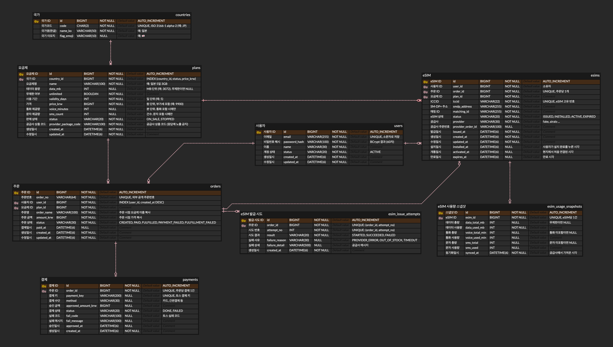

# 이심전심 (esim-jsim)

> 해외에 나갈 때 eSIM을 사고, 설정을 바꾸고, 유심을 끼우는 복잡한 과정을 줄일 수 없을까?

해외여행용 eSIM을 구매하고, 구매한 그 폰에서 버튼 한 번으로 설치 화면까지 가게 해 주는 서비스입니다. Java Spring Boot를 배우면서 혼자 만드는 학습 프로젝트이고, 웹으로 먼저 만든 뒤 앱으로 넓혀 갑니다.

## 왜 만드는가

- 해외에 나갈 때 유심칩을 바꿔 끼우거나, 앱을 깔고 등록한 뒤 설정에 들어가 회선을 바꾸는 과정이 복잡하게 느껴지는 사람이 많습니다. 구매부터 연결까지 이 과정을 최대한 줄이고 싶어서 만듭니다.
- "이렇게 되면 편할 텐데 왜 아직 없을까"가 출발점이었고, 조사해 보니 이유가 있었습니다.
- iOS와 Android는 일반 앱이나 웹이 eSIM을 직접 설치하거나 회선을 바꾸는 것을 허용하지 않습니다. 통신사와 승인된 앱만 가능합니다. 그래서 "완전 자동 연결"은 아직 없습니다.
- 대신 iOS 17.4부터는 웹 링크 하나로 시스템 eSIM 설치 화면을 열 수 있습니다. 이 프로젝트는 이 방법으로 "구매부터 설치까지 끊김 없는 흐름"을 만드는 것이 목표입니다.

조사 내용과 출처는 [docs/research-notes.md](docs/research-notes.md)에 있습니다.

## 핵심 흐름과 기능

```text
가입·로그인 → 요금제 선택 → 주문·결제 → eSIM 발급 → 폰에 설치 → 사용량 확인
   001           002          003          004         005          006
```

| 번호 | 기능 | 한 줄 설명 | 명세 | 상태 |
|------|------|-----------|------|------|
| 001 | 회원 가입과 로그인 | 이메일 가입, JWT 로그인, 내 정보 | [spec](specs/001-user-account/spec.md) · [tasks](specs/001-user-account/tasks.md) | 시작 전 |
| 002 | 국가별 요금제 조회 | 국가 목록, 국가별 요금제, 상세 | [spec](specs/002-plan-catalog/spec.md) · [tasks](specs/002-plan-catalog/tasks.md) | 시작 전 |
| 003 | 주문과 결제 | 주문 생성, 토스페이먼츠 테스트 결제 | [spec](specs/003-order-payment/spec.md) · [tasks](specs/003-order-payment/tasks.md) | 시작 전 |
| 004 | eSIM 발급 | 공급사 인터페이스로 발급, 실패 시 재시도 | [spec](specs/004-esim-issue/spec.md) · [tasks](specs/004-esim-issue/tasks.md) | 시작 전 |
| 005 | eSIM 설치 안내 | iPhone 원탭 링크, Android 코드 입력, QR | [spec](specs/005-install-guide/spec.md) · [tasks](specs/005-install-guide/tasks.md) | 시작 전 |
| 006 | 내 eSIM 상태와 사용량 | 목록, 데이터·통화·문자 사용량 | [spec](specs/006-my-esim-usage/spec.md) · [tasks](specs/006-my-esim-usage/tasks.md) | 시작 전 |

MVP 이후: 출국일 알림, 데이터 충전, 실제 공급사 연동, 모바일 앱.

## 기술 스택

| 영역 | 선택 |
|------|------|
| 언어 / 프레임워크 | Java 21, Spring Boot 3 |
| DB | MySQL 8 (테스트는 H2), Spring Data JPA |
| 인증 | Spring Security, JWT |
| 결제 | 토스페이먼츠 결제위젯 (테스트 키, 실제 돈이 나가지 않음) |
| eSIM 공급 | `EsimProvider` 인터페이스 + 가짜 구현 (실제 공급사는 MVP 이후) |
| 프론트엔드 | React, TypeScript (Vite), `frontend/` 폴더 |
| 테스트 | JUnit 5, MockMvc |

## ERD

테이블 8개, 관계 9개입니다. 컬럼 정의의 기준은 각 기능의 `data-model.md`입니다.



## 문서

| 문서 | 내용 |
|------|------|
| [기능별 요구사항 명세 (PDF)](docs/requirements.pdf) | 아래 명세 파일들을 한 권으로 묶은 것 |
| [기능별 공부 가이드 (PDF)](docs/study-guide.pdf) | Spring 기초부터 기능별 개념, 공식 문서, 구현 힌트, 점검 질문 |
| [프로젝트 원칙](.specify/memory/constitution.md) | 프로젝트 규칙, 기술 스택, API 공통 규칙 |
| [공부 가이드 원본](docs/study-guide/) | 장별 마크다운 |
| [ERD 이미지](docs/erd.png), [ERD SQL](docs/erd.sql) | 테이블 8개와 관계 9개. ERDCloud에서 직접 그린 것 |

### 명세 읽는 순서

기능마다 `specs/NNN-기능/` 폴더에 아래 파일이 있습니다.

1. `spec.md` : 무엇을 만드는가 (범위, 정책, 사용자 시나리오, 요구사항)
2. `plan.md` : 어떻게 만드는가 (처리 흐름, 설계 결정, 패키지 구조)
3. `data-model.md` : 테이블과 Entity
4. `contracts/api.md` : API 요청·응답, DTO, 에러 코드
5. `tasks.md` : 직접 구현할 작업 체크리스트

## 일하는 방식

### 직접 구현한다

이 프로젝트의 목적은 배우는 것입니다. 구현 코드는 직접 작성합니다. AI 도구는 명세 작성, 개념 설명, 힌트, 코드 리뷰에만 씁니다.

### 브랜치

| 브랜치 | 용도 | 규칙 |
|--------|------|------|
| `main` | 항상 돌아가는 완성본 | 직접 커밋하지 않음. 기능이 끝나고 테스트가 통과하면 `develop`에서 합침 |
| `develop` | 개발 중인 코드가 모이는 곳 | 기능 브랜치를 Pull Request로 합침 |
| `001-user-account` 같은 기능 브랜치 | 기능 하나를 만드는 곳 | `develop`에서 따고, PR을 올려 스스로 점검한 뒤 `develop`에 합침 |

```text
develop ──┬── 001-user-account ──PR──▶ develop ──(기능 완료, 테스트 통과)──▶ main
          └── 002-plan-catalog ──PR──▶ develop
```

### 작업 순서

1. 기능의 `spec.md`와 `plan.md`를 읽는다.
2. 공부 가이드의 같은 번호 장에서 모르는 개념을 공부한다.
3. `develop`에서 기능 브랜치를 만든다.
4. `tasks.md`를 위에서부터 하나씩 구현하고 `[ ]`를 `[x]`로 바꾼다.
5. Pull Request를 올리고, 바뀐 코드를 처음부터 다시 읽으며 스스로 점검한다. AI에게 코드 리뷰를 받아도 된다.
6. 구현 중 명세가 바뀌면 코드보다 문서를 먼저 고친다.

## Spec Kit

이 저장소는 [GitHub Spec Kit](https://github.com/github/spec-kit)의 명세 주도 개발 구조를 따릅니다. Claude Code에서 아래 명령을 쓸 수 있습니다.

| 명령 | 용도 |
|------|------|
| `/speckit-specify` | 새 기능 명세 작성 (007 이후) |
| `/speckit-clarify` | 명세의 모호한 부분 질문 받기 |
| `/speckit-plan` | 구현 계획 작성 |
| `/speckit-tasks` | 작업 목록 생성 |
| `/speckit-analyze` | 문서 간 불일치 점검 |
| `/speckit-implement` | AI가 대신 구현. **이 프로젝트에서는 사용하지 않음** |

## 만든 사람

진행 ([@ehgo508](https://github.com/ehgo508)). 혼자 진행하는 프로젝트입니다.
